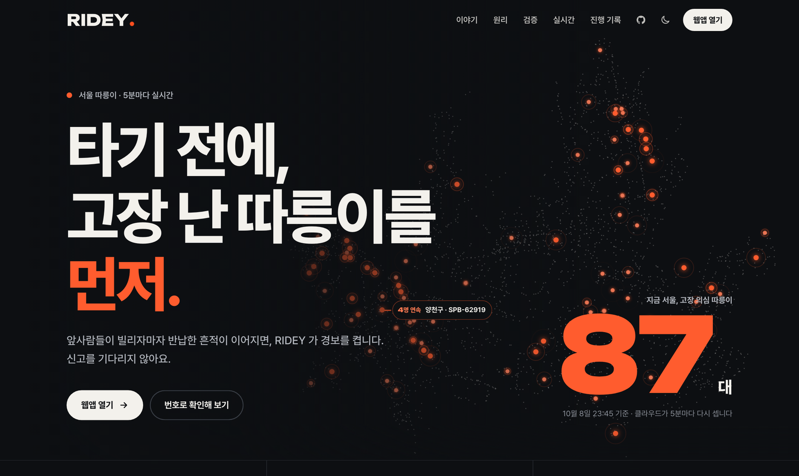
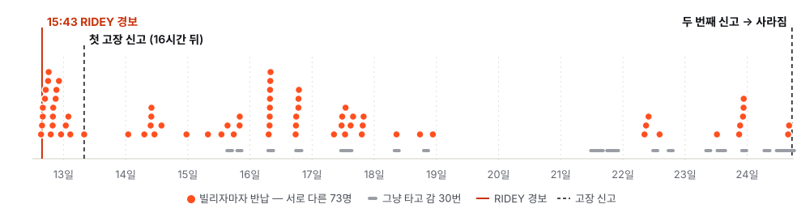
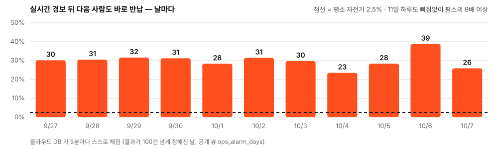
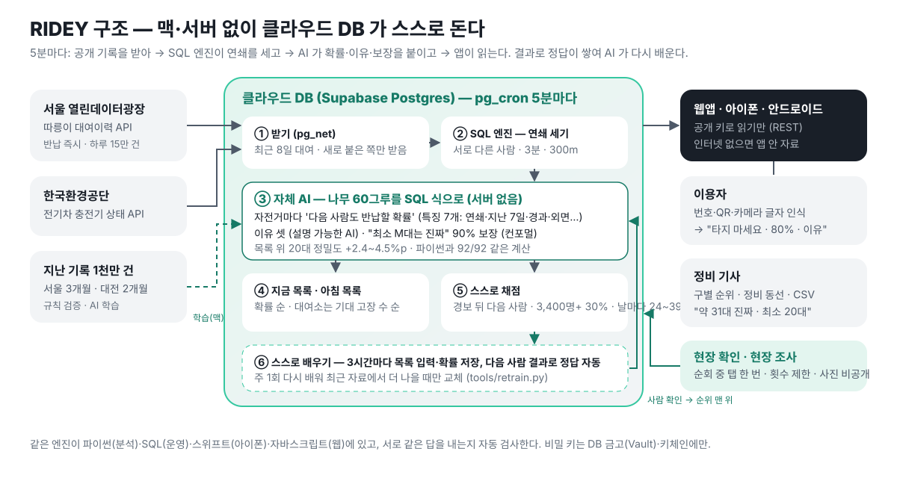
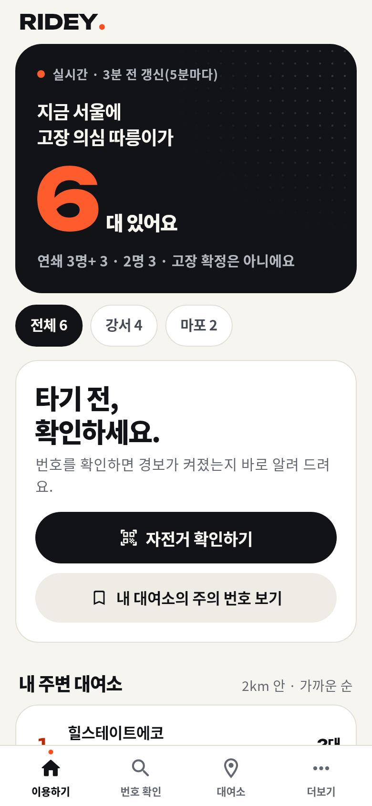
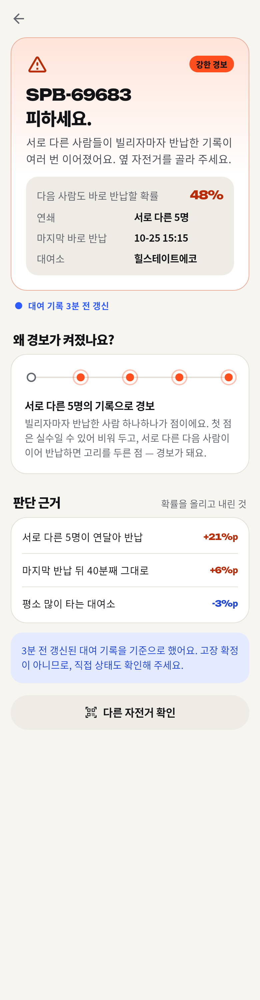
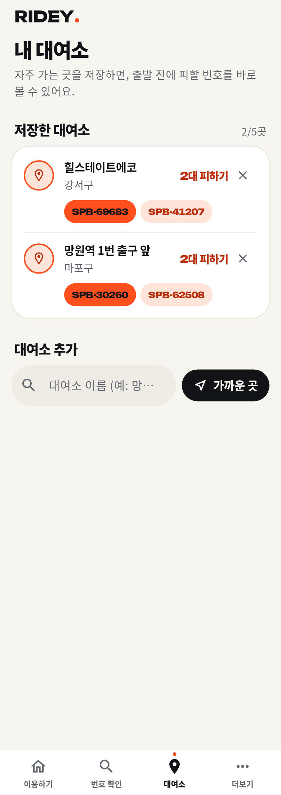
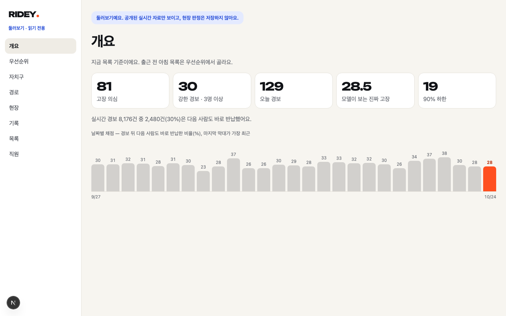
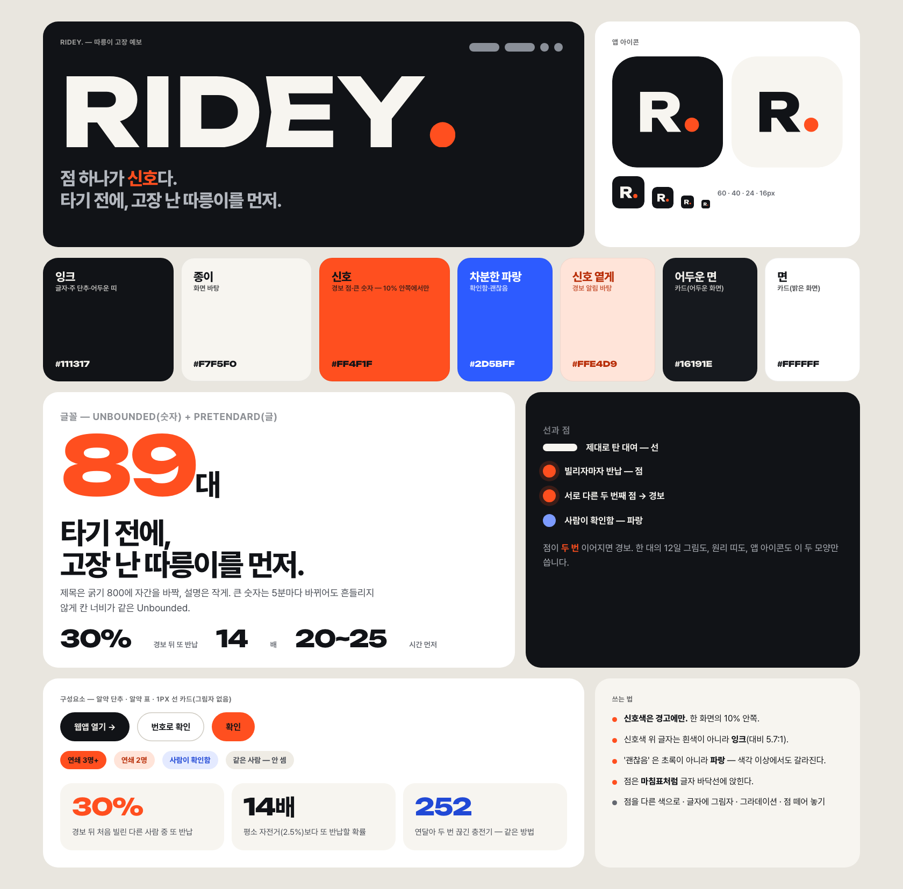

<h1 align="center"><picture>
  <source media="(prefers-color-scheme: dark)" srcset="docs/brand/wordmark-dark.svg">
  
</picture></h1>

<p align="center">타기 전에, 고장 난 따릉이를 먼저 알려 주는 앱</p>

<p align="center">
  <a href="https://zmflm0110.github.io/ridey/"></a>
  <a href="https://zmflm0110.github.io/ridey/app/"></a>
  <a href="https://github.com/zmflm0110/ridey/actions/workflows/test.yml"></a>
  <a href="https://github.com/zmflm0110/ridey/actions/workflows/flutter.yml"></a>
  <a href="https://github.com/zmflm0110/ridey/actions/workflows/dashboard.yml"></a>
  <a href="LICENSE"></a>
</p>

<p align="center">
  <a href="https://zmflm0110.github.io/ridey/">웹사이트</a> ·
  <a href="https://zmflm0110.github.io/ridey/app/">웹 데모</a> ·
  <a href="docs/report.pdf">보고서</a> ·
  <a href="docs/slides.pdf">발표</a> ·
  <a href="docs/demo/demo.mp4">시연 영상</a> ·
  <a href="CHANGELOG.md">진행 기록</a>
</p>

<p align="center">
  <a href="https://zmflm0110.github.io/ridey/"></a>
</p>

따릉이가 고장 나도 신고하는 사람은 많지 않다. 대신 빌렸다가 이상하다 싶으면 그 자리에서 바로 반납한다. 이런 반납이 서로 다른 사람에게서 연달아 나오는 자전거는 고장일 가능성이 높다. RIDEY는 서울시가 공개하는 대여 기록에서 이런 자전거를 찾아, 보통 고장 신고보다 하루쯤 먼저 알려 준다.

## 자전거 한 대의 12일

<picture>
  <source media="(prefers-color-scheme: dark)" srcset="docs/img/spb69683-dark.svg">
  
</picture>

서울 강서구의 실제 자전거 SPB-69683이다. 2026년 6월 대여 기록과 고장 신고를 그대로 그렸다([`analysis/spb69683.py`](analysis/spb69683.py)).

- 6월 12일 15:20에 첫 사람이 빌리자마자 같은 대여소에 반납했고, 15:43에 두 번째 사람도 그랬다. RIDEY라면 여기서 경보를 켠다.
- 첫 고장 신고는 다음 날 07:58에 들어왔다. 그런데도 그 뒤로 54번 더 빌려졌다가 바로 반납됐다.
- 6월 16일 출근길(07:13\~07:50)에는 37분 동안 7명이 연달아 헛걸음했다.
- 6월 24일 두 번째 신고가 들어온 뒤에야 사라졌다. 그동안 돌아선 사람이 서로 다른 73명이다.

## 왜 지금은 못 찾나

- 신고를 잘 안 한다. 여러 사람이 연달아 포기한 자전거의 49\~61%는 7일이 지나도 신고가 없었다([보고서 5-3](docs/report.md)).
- 눈으로 봐서는 모른다. 공단은 하루 한 번 넘게 대여소를 돌고 수거의 절반을 신고 없이 찾아낸다. 그래도 경보가 켜진 자전거의 82\~91%는 하루 안에 또 빌려졌다. 체인이나 브레이크처럼 타 봐야 아는 고장이 많기 때문이다([공단 운영 조사](docs/operations.md), [`after_alarm.py`](analysis/after_alarm.py)).
- 규모도 작지 않다. 2024년 고장 접수가 16만 건이었고 운영 적자는 127억 원이었다([헤럴드경제](https://biz.heraldcorp.com/article/10878875)).

## 규칙

| 말 | 뜻 |
|---|---|
| 헛대여 | 같은 대여소에 3분 안에, 300m도 안 가고 반납한 것. 타 보려다 포기한 흔적으로 본다 |
| 서로 다른 사람 | 한 사람이 여러 번 한 건 한 번으로 센다(생년·성별, 없으면 '반납 2분 안 재대여'로 구분) |
| 경보 | 서로 다른 사람의 헛대여가 2명 이어지면 경보, 3명 이상이면 강한 경보 |
| 끝 | 누군가 정상으로 타고 가면 풀린다 |

기준은 2026년 1월 기록만 보고 정했고, 3월·6월과 대전 타슈 기록에는 손대지 않고 그대로 적용했다([phase1](docs/phase1.md)). 시간·거리·인원을 바꾼 기준 18가지를 서울 세 달, 대전 두 달 기록에 모두 돌려 봤는데, 1월에 고른 기준이 처음 보는 달과 도시에서도 51.8\~60.2%였다. [사이트의 기준 탐색기](https://zmflm0110.github.io/ridey/#proof)에서 직접 바꿔 볼 수 있다(`analysis/rule_grid.py`).

## 결과

<p align="center"></p>

| 무엇 | 결과 | 근거 |
|---|---|---|
| 서로 다른 두 사람이 포기한 뒤 다음 사람 | 35\~44%가 또 바로 반납(평소 자전거는 2.5%) | [results](docs/results.md) |
| 신고보다 얼마나 빠른가 | 경보에서 고장 신고까지 중앙값 20\~25시간, 그사이 한 대에서 평균 4명이 헛걸음 | [보고서 5-3](docs/report.md) |
| 막을 수 있던 헛걸음 | 서울 하루 90\~243명, 대전 하루 114\~132명 | [보고서 5-2](docs/report.md) |
| 검증한 기록 | 서울 3개월과 대전 2개월, 약 1천만 건 | [results](docs/results.md) |
| 정비 동선 | 근무 시간 안에 많이 막는 순서로 돌면 순위대로 돌 때보다 12\~17% 더 막음 | [route_backtest](docs/route_backtest.md) |

## 실시간으로 돌아가는 방식

서울 대여이력 API는 반납이 끝나면 바로 그 기록을 준다. 그래서 2026년 9월 27일부터는 클라우드 DB(Supabase)가 5분마다 직접 기록을 받아 계산하고, 앱은 그 결과를 읽기만 한다. 따로 켜 둔 서버나 컴퓨터는 없다.

10월 8일까지 실제로 돌려 본 결과, 경보가 켜진 뒤 처음 빌린 다른 사람 3,478명 중 1,035명(29.8%)이 또 바로 반납했다. 지난 기록으로 잰 32\~34%와 비슷하고, 11일 동안 날마다 24\~39% 사이였다. 5분 작업은 하루 288번 모두 성공했고 한 번에 평균 19초 걸렸다. 최신 숫자는 [웹사이트](https://zmflm0110.github.io/ridey/#live)에서 볼 수 있다.

<picture>
  <source media="(prefers-color-scheme: dark)" srcset="docs/img/ops-days-dark.svg">
  
</picture>

<p align="center"></p>

## 자체 모델은 규칙보다 나을 때만

규칙만으로도 쓸 만하다. 그래서 모델은 규칙과 같은 조건에서 비교해 더 나은 곳에만 넣었다([model](docs/model.md)).

- 목록의 자전거마다 '다음 사람도 바로 반납할 확률'을 낸다. 나무 60그루짜리 모델(특징 7개: 연쇄, 지난 7일, 경과 시간 등)을 SQL 식으로 바꿔 DB 안에서 5분마다 계산한다.
- 확률 순으로 보여 주면 위 20대 중 진짜 고장이 세 달 모두 2.4\~4.5%p 늘었다.
- '이 중 최소 몇 대는 진짜 고장'을 90%로 보장하는 하한(분할 컨포멀)도 낸다. 시험한 달에서는 98\~100% 맞았다.
- 왜 그렇게 봤는지도 같이 보여 준다. 예: '서로 다른 12명이 연달아 반납 +36%p'.
- 3시간마다 표본을 모으고 다음 사람의 결과를 정답으로 써서 다시 배운다. 실시간 3,215개로 점검해 보니 목록 단위 예측 34.3%, 실제 34.7%였다. 경보 순간만 보면 35%와 29%로, 연쇄 2명을 조금 높게 본다. 이를 고치는 보정 층도 매번 같은 기준으로 시험하는데, 지금은 개선이 1.7%로 기준(2%)에 못 미쳐 아직 바꾸지 않았다([model_live](docs/model_live.md)).
- 서울로만 배운 모델을 대전에 그대로 써도 위 10대 기준 4.5%p 나아졌다([model_daejeon](docs/model_daejeon.md)).

## 화면

이용자 앱(Flutter, 안드로이드·아이폰)과 직원용 운영 화면(Next.js), 설치 없이 보는 웹 데모가 있다. 셋 다 같은 자료를 쓰고 같은 디자인 규칙을 따른다.

<table>
  <tr>
    <td align="center"><br>홈<br><sub>지금 서울의 고장 의심 대수, 구별로 거르기</sub></td>
    <td align="center"><br>자전거 상세<br><sub>확률, 연쇄, 판단 근거</sub></td>
    <td align="center"><br>내 대여소<br><sub>자주 가는 곳의 피할 번호</sub></td>
  </tr>
</table>

<p align="center"><br><sub>운영 화면 개요. 직원 계정이 없을 때는 RIDEY_DEMO=1로 읽기 전용으로 볼 수 있다</sub></p>

대여소 QR 스티커도 만들 수 있다. [사이트](https://zmflm0110.github.io/ridey/#stk)에서 대여소를 고르면 100×140mm 스티커가 나온다. 기둥에 붙여 두면 카메라로 비추기만 해도 웹 데모가 `app/?s=대여소번호`로 열려, 그 대여소에 지금 있는 의심 자전거 번호를 보여 준다.

## 디자인

빌려서 제대로 탄 기록은 선, 빌리자마자 반납한 기록은 점으로 그린다. 서로 다른 두 사람의 점이 이어지면 경보이고, 로고 `RIDEY.`의 마침표가 그 점이다. 바탕은 잉크색과 종이색, 경보에만 주황을 쓰고 '확인함'은 파랑으로 한다. 초록 대신 파랑을 고른 건 색각 이상이 있으면 주황과 초록이 거의 같아 보이기 때문이다(ΔE 16). 숫자는 Unbounded 글꼴, 글은 기기 기본 글꼴이다. 자세한 규칙은 [docs/brand.md](docs/brand.md)에 있다.

<p align="center"></p>

## 다른 곳에도 쓸 수 있을까

- 대전 타슈: 서울 기준을 그대로 썼을 때 두 명이 포기한 뒤 다음 사람도 포기한 비율이 41.6\~43.6%였다(평소 2.9%).
- 전기차 충전기: 2026년 8월 권익위가 전기차 충전 민원주의보를 냈다(3년 사이 1.8배). 앱에는 '사용 가능'인데 실제로는 안 되는 충전기를 같은 방법으로 찾아봤다. 연달아 두 번 바로 끊긴 충전기 252대 중 다음 충전도 36.5%가 바로 끊겼다(평소 2.7%). 다만 사람을 구분할 수 없고 정답 자료가 없어서 아직은 가능성만 본 단계다([ev_validation](docs/ev_validation.md)).

## 만든 방법

| 부분 | 쓴 것 |
|---|---|
| 엔진 | 파이썬(`engine/`). 같은 규칙을 SQL, 자바스크립트(웹), 타입스크립트(운영 화면)로도 짰고 서로 같은 답이 나오는지 자동으로 검사한다 |
| 클라우드 | Supabase Postgres. pg_cron으로 5분마다, pg_net으로 서울 API를 받고 SQL로 연쇄와 확률을 계산한다. 키는 DB의 Vault와 맥 키체인에만 둔다 |
| 앱 | 이용자 앱은 Flutter(카메라 QR, 번호판 글자 인식, 끊기면 마지막 기록), 운영 화면은 Next.js, 웹 데모는 바닐라 JS와 Leaflet(오프라인 동작) |
| 검사 | 파이썬 35개, Flutter 34개, 운영 화면 19개, 웹 화면 검사. 올릴 때마다 GitHub Actions가 돌고 APK도 여기서 만든다 |

무료 DB(메모리 0.5GB)가 10월 2일 밤 6시간 멈춘 적이 있다. 5분 작업 한 번이 145MB를 건드려서 DB 캐시가 디스크로 밀려난 탓이었다. '헛대여가 둘 이상 이어져야 경보'라는 조건으로 후보를 먼저 줄이고(답은 같다), 자전거별 기록을 색인에서 바로 읽게 고쳐 한 번에 40MB, 16\~20초로 줄였다. 옛 SQL과 새 SQL이 같은 답을 내는지는 로컬 Postgres에 6월 기록을 흘려 넣어 36시간 동안 73번 비교했다([`tools/live_sql_compare.py`](tools/live_sql_compare.py)).

## 한계

- 고장의 정답 자료가 없다. 고장 신고는 늦고 드물어서, 다음 사람도 바로 반납했는지를 정답 대신 쓴다. 현장에서 직접 확인하는 조사를 준비해 두었다([절차](docs/field_protocol.md)).
- 아무도 빌리지 않은 고장은 못 찾는다. 흔적이 있어야 찾는다.
- 고장 종류는 못 맞힌다. 평균으로는 단말기 고장이 더 빨리 반납되지만, 한 대씩 맞혀 보면 10\~14%뿐이라 종류는 현장에서 봐야 한다.

## 직접 돌려 보기

인증키 없이 공개 자료만으로 모든 표를 다시 만들 수 있다.

```sh
python3 -m venv .venv && .venv/bin/pip install -r requirements.txt
.venv/bin/python data/download.py          # 원본 자료 (약 1.7GB)
.venv/bin/python analysis/report.py        # 주요 표 (docs/results.md)
.venv/bin/python server/app.py             # 웹 데모 (http://localhost:8765)
.venv/bin/python -m pytest -q tests        # 파이썬 테스트
```

<details>
<summary>클라우드 실시간 켜기 (Supabase, 서울 열린데이터광장 인증키)</summary>

키는 코드나 git에 넣지 않는다. 맥에서는 키체인에(`-w`로 끝내면 화면에 안 보이게 묻는다), 클라우드에서는 Supabase Vault에 둔다.

```sh
security add-generic-password -a bike-doctor -s seoul-openapi -w      # 서울 열린데이터광장
security add-generic-password -a bike-doctor -s datagokr -w           # 공공데이터포털 (충전기, 선택)
security add-generic-password -a bike-doctor -s supabase-db -w        # Supabase DB 비밀번호
```

1. Supabase 프로젝트에 `supabase/schema.sql`(쓰기 표), `staff.sql`(직원 명단과 권한), `model.sql`(모델 식), `live.sql`(5분 작업), `ev.sql`(충전기), `calib.sql`(보정) 순서로 적용한다. 클라우드에는 DB 비밀번호로 psql에서 직접 적용한다.
2. Vault에 `seoul_openapi`(필요하면 `datagokr`)를 넣고, 처음에는 `tools/supabase_live_load.py --stations --backfill 8`로 채운다.
3. 공개(publishable) 키를 `web/cloud.js`, `app/lib/config/ridey_config.dart`, 운영 화면의 `dashboard/.env.local`에 넣는다.

확인은 `select at, ms from live.tick_log order by at desc limit 5`로 한다. 파이썬과 같은 답인지는 `tools/supabase_live_load.py --parity`, `--parity-model`로 본다. 충전기 기록은 클라우드에 3일만 남으니 3일 안에 `tools/ev_pull.py` 다음 `analysis/ev_validate.py`를 돌린다. 모델 점검과 다시 배우기는 `tools/retrain.py`(`--deploy`는 나아졌을 때만 바꾼다).
</details>

<details>
<summary>안드로이드, 아이폰</summary>

- 안드로이드 APK는 GitHub Actions의 `flutter` 실행 화면에서 `ridey-apk`로 받는다. 테스트를 통과해야 만들어진다. 직접 만들려면 `cd app && flutter build apk --release`. `app/android/key.properties`(git에 넣지 않음)가 있으면 그 키로, 없으면 디버그 키로 서명한다.
- 아이폰은 `cd app && flutter build ios` 또는 Xcode에서 `app/ios/Runner.xcworkspace`를 열고 Team을 고른 뒤 실행한다.
- 앱 아이콘과 시작 화면은 `node tools/make_flutter_assets.js`로 다시 만든다(`web/icon.svg`, `docs/brand/wordmark-dark.svg`에서).
- 같은 Actions 실행의 `ridey-screens`에는 주요 화면을 밝은 화면과 어두운 화면으로 찍은 사진이 있다. Flutter가 없는 컴퓨터에서도 디자인을 확인할 수 있다.
- 10월 25일 Flutter로 옮기기 전의 SwiftUI 아이폰 앱(`ios/`)과 Capacitor 안드로이드 앱(`android-app/`)은 커밋 `b561e16` 이전 기록에 남아 있다.
</details>

<details>
<summary>검사와 제출물 다시 만들기</summary>

```sh
npm i playwright marked
node tests/web/smoke.js                                                          # 웹 데모 다섯 탭 휴대폰 화면 검사
PW_EXPERIMENTAL_SERVICE_WORKER_NETWORK_EVENTS=1 node tests/web/offline.js evict  # 오프라인 시연
SHOTS=docs/shots node tests/web/smoke.js                                         # 웹 데모 화면 사진
node tests/web/record_demo.js                                                    # 시연 영상 (ffmpeg 필요)
node docs/build_pdf.js                                                           # 보고서·제안서·발표 PDF
.venv/bin/python tools/build_site.py                                             # 웹사이트
(cd app && flutter test)                                                         # 이용자 앱
(cd dashboard && npm test)                                                       # 운영 화면
python tools/live_sql_compare.py --old <커밋>                                     # 클라우드 SQL을 고칠 때 옛·새 답 비교 (로컬 Postgres)
```

대회 제출 zip은 `python tools/make_submission.py --id <학번> --name <이름>`으로 만든다. APK는 Actions에서 받은 것을 `dist/RIDEY.apk`로 두면 된다.
</details>

## 이용자 앱과 운영 화면

이용자가 쓰는 앱과 직원이 쓰는 화면을 나눴다. 고장 판단 엔진(`engine/`)과 분석 SQL(`supabase/live.sql`, `model.sql`, `calib.sql`, `ev.sql`)은 바꾸지 않았다.

| | 위치 | 누가 쓰나 |
|---|---|---|
| 이용자 | [`app/`](app/README.md) Flutter. 홈, 번호·QR·번호판 조회, 내 대여소, 자전거 상세. 조회 기록과 알림 설정은 그 폰 안에만 남는다 | 누구나 |
| 운영 | [`dashboard/`](dashboard/README.md) Next.js. 개요, 우선순위 지도, 자치구, 근무 동선, 현장 판정, 기록과 아침 목록 CSV, 직원 명단 | 초대받은 직원. 로그인 세션, `ops.staff`, RLS가 함께 막는다 |

누구나 읽을 수 있는 뷰는 `live_snapshot`, `ops_lists`, `ops_scores`, `ops_alarm_days` 네 개다. `rescue`, `survey`, 사진, `checked`, `field_records`는 활성 직원만 읽고 쓴다. 직원 명단 스키마 `ops`는 API에 열지 않는다. 클라우드에 `staff.sql`을 적용하기 전까지는 웹 데모의 익명 쓰기가 그대로 열려 있다.

`web/`은 설치 없이 보는 웹 데모이자 대여소 QR 스티커가 여는 페이지라서 남겨 두었다(`test.yml`, `pages.yml`이 쓴다). `site/`는 작품 소개 사이트다. 대여소 목록을 새로 만들면 `analysis/export_web.py`가 `web/data/stations.json`을 쓰고, 이 파일을 `app/assets/data/stations.json`과 `dashboard/data/stations.json`에 복사한다.

## 폴더

| 폴더 | 내용 |
|---|---|
| [`engine/`](engine) | 헛대여, 연쇄, 경보 규칙(`core.py`), 아침 목록(`morning.py`), 충전기(`ev.py`) |
| [`supabase/`](supabase) | 5분 작업(`live.sql`), 모델 식(`model.sql`), 충전기(`ev.sql`), 쓰기 표(`schema.sql`), 직원 명단(`staff.sql`) |
| [`app/`](app/README.md) | 이용자 Flutter 앱 |
| [`dashboard/`](dashboard/README.md) | 직원용 운영 화면(Next.js). 로그인해야 열린다. 시연용 읽기 전용 모드는 `RIDEY_DEMO=1` |
| [`analysis/`](analysis) | 검증 스크립트. 기준 고르기, 실시간 대조, 모델 학습과 비교, 공단 순회 효과, 그림 |
| [`web/`](web) | 웹 데모. 지금 목록, 조회(QR), 현장 확인, 하루 재생, 현장 조사. 오프라인에서도 동작 |
| [`site/`](site) | 작품 소개 웹사이트(GitHub Pages) |
| [`docs/`](docs/README.md) | 보고서, 발표, 대본, 결과 표, 조사 자료([문서 목록](docs/README.md), [스토리라인](docs/story.md)) |
| [`tools/`](tools) | 클라우드 적재와 대조, SQL 비교, 다시 배우기, 제출물 만들기 |
| [`tests/`](tests) | 파이썬, 웹 화면, 오프라인 검사(앱과 운영 화면 검사는 각 폴더 안) |

측정 과정과 실패한 시도는 [`PLAN.md`](PLAN.md)에, 바뀐 점은 [`CHANGELOG.md`](CHANGELOG.md)에 적어 두었다.

## 자료와 참고

- 자료: 서울 열린데이터광장의 따릉이 대여이력([OA-15182](https://data.seoul.go.kr/dataList/OA-15182/F/1/datasetView.do), 실시간 API `tbCycleRentData`), 고장신고([OA-15644](https://data.seoul.go.kr/dataList/OA-15644/F/1/datasetView.do)), 대여소 정보. 공공데이터포털의 대전 타슈 대여이력과 한국환경공단 전기차 충전기 상태. 모두 공공누리 제1유형이다. 앱과 공개 화면에는 이용자 정보(생년, 성별)가 없고, 클라우드는 대여 기록을 8일만 둔다.
- 참고 연구: Kaspi, Raviv, Tzur, [Detection of Unusable Bicycles in Bike-Sharing Systems](https://www.researchgate.net/publication/290496984_Detection_of_Unusable_Bicycles_in_Bike-Sharing_Systems) (Omega, 2016), [Self-Supervised Transformer for Unusable Shared Bike Detection](https://arxiv.org/pdf/2505.00932) (2025). 비교는 [related_work](docs/related_work.md)에 있다.
- 라이브러리: 웹은 [Leaflet](https://leafletjs.com) 1.9.4(BSD-2), [jsQR](https://github.com/cozmo/jsQR) 1.4.0(Apache-2.0)을 `web/vendor/`에 라이선스와 함께 넣었다. 앱은 Flutter와 pub.dev 패키지, 운영 화면은 Next.js, React, Supabase JS를 쓴다. 전체 목록은 [docs/credits.md](docs/credits.md). 지도는 © OpenStreetMap 기여자. 글꼴은 Unbounded(OFL)에서 숫자와 대문자만 잘라 넣었다.
- 라이선스: 코드는 [MIT](LICENSE). 자료는 각 출처의 공공누리 제1유형(출처 표시)을 따른다.
